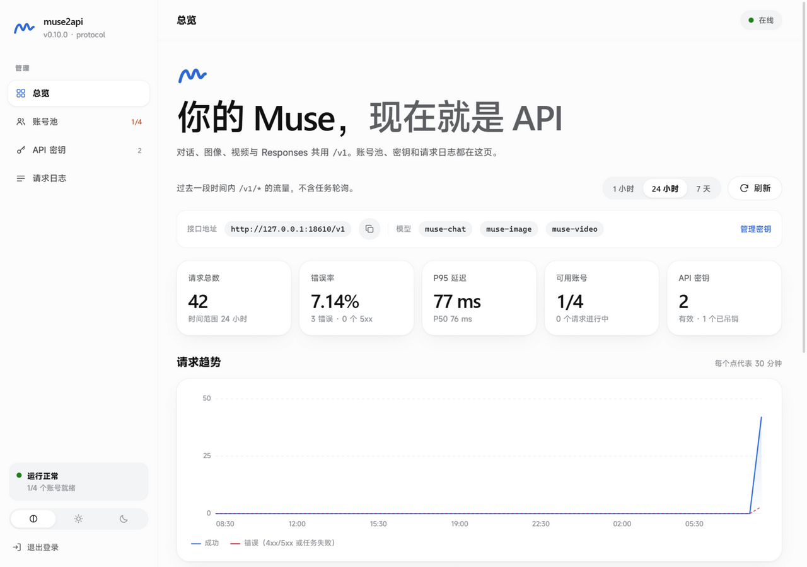

# muse2api

> 把 muse.ai 网页里的 Agent，变成一个标准的 OpenAI API。

muse2api 是一个自托管的**网页反代网关**：对外提供 `/v1/chat/completions`、`/v1/responses`、`/v1/images/generations`、`/v1/videos` 这些标准的 OpenAI 接口，对内通过 muse.ai 网页端使用的原生 Noise 协议直连它的 Agent。

它不点浏览器、不往聊天框里粘贴提示词，而是直接使用 muse.ai 自己的会话、线程、附件、客户端工具和生图/生视频通道。任何 OpenAI SDK、聊天客户端或 Agent 框架，把 `base_url` 指过来就能用。

## 特性

- **纯协议驱动**：Noise XX + `chat.stream` + 线程订阅，不需要 Chromium。`Dockerfile.protocol` 镜像约 194 MB，冷启动只付一次握手（网关启动时预热）。
- **对外只说 OpenAI 协议**：流式 SSE、`tool_calls`、`response_format`、`stop`、`n>1`（含流式多选）、`max_tokens`、`stream_options`、`system_fingerprint`；404/405/校验错误一律 OpenAI 错误信封，响应带 `x-request-id` / `openai-version` / `openai-processing-ms`。调用方无法从信封形状上分辨它与 api.openai.com。
- **附件真的能读**：`file` / `input_file` / `input_audio` 内容部件会作为 `file_ref` 附件上传到账号 VM，Agent 读取文件内容后回答（逆向实测：从上传的 txt 里精确读回指定密语）。
- **Responses API 完整可用**：`previous_response_id` 有状态续聊（落盘，重启不丢）、`tools`/`tool_choice` 函数调用、完整流式事件序、`max_output_tokens` 截断语义。
- **系统提示词生效**：`system` / `developer` 消息走"VM 托管规则 + 会话内指令块"两层注入，模型会真正跟随角色、格式与约束。
- **工具调用走原生通道**：OpenAI `tools` 注册成 muse.ai 的原生客户端命令，Agent 在自己的工具循环里调用，再还原成标准 `tool_calls`；Planner 兜底。
- **单账号真并发**：逆向实测上游按 VM 并行执行轮次（单连接 12 条并发流零错误），网关用连接池 + 每账号 12 并发把这份能力交给调用方。
- **异常路径干净**：客户端断开、超时、换号重试都会真正取消上游正在执行的轮次，被中止的线程直接丢弃，不会把半截回复泄漏进下一轮。
- **多账号、多会话**：账号池负责调度、冷却与故障转移；会话按 API Key 隔离，热线程复用降低首字延迟。
- **图片与视频**：文生图、参考图、异步任务、文生视频、透明背景抠图都在同一个网关里。
- **自带控制台**：账号池、API 密钥、请求日志与流量统计；界面沿用 muse.ai 的视觉语言（米白画布、药丸控件、克制的蓝色、轻量动效），浅色/深色/跟随系统，移动端可用，零外部依赖。

## 快速开始

### Docker（推荐）

```bash
cp .env.example .env          # 按需修改
docker compose up -d --build  # 浏览器驱动镜像（含 Chromium）
```

纯协议驱动更轻，直接构建协议镜像：

```bash
docker build -f Dockerfile.protocol -t muse2api:protocol .
docker run -d --name muse2api \
  --restart unless-stopped \
  -p 18610:18610 \
  -v "$PWD/data:/app/data" \
  -e MUSE2API_DRIVER=protocol \
  -e MUSE2API_UPSTREAM_PROXY=http://<proxy>:7893 \
  muse2api:protocol
```

服务默认监听 `127.0.0.1:18610`。首次启动如果没有设置 `MUSE2API_API_KEY`，会自动生成一个密钥并保存到 `data/api_key`。

### 本地运行

```bash
python3 -m venv .venv
source .venv/bin/activate          # Windows: .venv\Scripts\activate
pip install -e '.[dev]'
python -m muse2api
```

默认的 `mock` 驱动不需要账号、不访问网络，适合先跑通接口与控制台。

### 放入一个 muse.ai 账号

从已登录 muse.ai 的浏览器导出 Cookie，至少需要 `hatch_sess` 和 `hatch_native_auth_device`：

```bash
curl http://localhost:18610/admin/accounts \
  -H "Authorization: Bearer $ADMIN_KEY" \
  -H "Content-Type: application/json" \
  -d '{"label":"main","cookies":{"hatch_sess":"...","hatch_native_auth_device":"..."}}'
```

也可以打开 `http://localhost:18610/`，在「账号池」页下载 Chrome 插件，一键读取 httpOnly Cookie 并导入；「批量导入」支持一次粘贴多行。

### 客户端配置

| 字段 | 值 |
|---|---|
| API Base | `http://<网关地址>:18610/v1` |
| API Key | `MUSE2API_API_KEY`，或控制台创建的 `m2a-...` 密钥 |
| 模型 | `muse-chat`、`muse-image`、`muse-video`；`gpt-4o` 等常见名称仅作兼容别名，不出现在 `/v1/models` |
| 超时 | 建议 ≥ 240 秒（muse.ai 冷启动较慢） |

```python
from openai import OpenAI

client = OpenAI(base_url="http://localhost:18610/v1", api_key="<API_KEY>")
resp = client.chat.completions.create(
    model="muse-chat",
    messages=[{"role": "user", "content": "写一首关于秋天的短诗"}],
)
print(resp.choices[0].message.content)
```

浏览器端应用（Open WebUI、LobeChat web、LibreChat 等）也可以直接调用：`/v1/*` 默认返回 `Access-Control-Allow-Origin: *`，与 api.openai.com 一致。需要收紧时设置 `MUSE2API_CORS_ORIGINS=逗号分隔的来源列表`。

## 控制台

打开 `http://<host>:18610/`，输入管理密钥（`MUSE2API_ADMIN_KEY`，未设置时回退到 `data/api_key`）。页面是单文件、无外部依赖，密钥只保存在浏览器的 localStorage。



- **总览**：请求总数、错误率、P95 延迟、可用账号、密钥用量；请求趋势图与密钥/账号/模型/状态码分布，支持 1 小时 / 24 小时 / 7 天。
- **账号池**：每个账号一张卡片，显示状态、成功/失败计数、额度进度、Cookie 过期时间与最近错误；操作包括续期、重置、看请求、刷新额度、启禁用、删除。支持批量导入与插件下载。
- **API 密钥**：创建、重命名、吊销、恢复、删除；每个密钥的请求量、错误数与最近使用时间。明文只在创建时显示一次。
- **请求日志**：按密钥、账号、状态、路径过滤，自动刷新与分页；点击一行查看完整字段（模型、耗时、流式、任务状态、客户端 IP、User-Agent）。

界面沿用 muse.ai 的视觉语言：米白画布、药丸形控件、单一蓝色强调，以及数字滚动、图表描边、页面淡入等轻量动效。提供"跟随系统 / 浅色 / 深色"三种主题；窄屏下侧栏收进抽屉，表格自动折叠成卡片。

## 请求是怎么走的

```text
OpenAI 客户端
     │  HTTP + Bearer Key
     ▼
┌──────────────┐   账号池 / 故障转移 / 会话隔离 / 请求日志
│   muse2api   │───────────────────────────────────────────┐
└──────────────┘                                           │
     │  Noise XX + protobuf + chat.stream                   │
     ▼                                                      ▼
muse.ai 网页 Agent  ──  系统指令 · 线程 · 客户端工具  ──  图片 / 视频
```

一次聊天请求会经历这些步骤：

1. 路由解析模型别名，把多轮 `messages` 与 `system` 指令整理成一条提示词；
2. 网关从账号池租一个账号，驱动建立或复用 muse.ai 线程；
3. 上游的 `delta.text_append` 直接变成 OpenAI `delta.content`；
4. 出错时按类型更新账号状态，在尚未向客户端发送内容前自动换号重试；
5. 流式请求先拿到第一个 chunk 再返回 200，避免"中途断流"。

## 兼容层细节

### 系统提示词

muse.ai 的 `chat.stream` 没有独立的 `system` 角色。网关用两层机制逼近真正的 system 语义：

1. **VM 托管规则**：Agent 每次会话开始都会读取账号 VM 里的 `IDENTITY.md` / `SOUL.md` / `AGENTS.md`，服务端还会逐轮重新注入。网关在这三个文件末尾维护一段带标记的托管规则（跟随 system 指令、禁用账号记忆工具、优先使用已注册客户端命令）。原文件先备份到 `data/harness_backup/`，`POST /admin/harness/{id}/restore` 可随时还原。
2. **会话内指令块**：`system` / `developer` 消息收集成前置指令块，当前用户消息单独放在最后；后续轮次只发送新的用户轮。指令内容变化会换新线程，避免新旧规则混用。

实测（真实 muse.ai 全链路）：带 system 的会话里，模型自称 system 定义的姓名、精确跟随输出格式、不泄露账号主人的记忆。完整逆向记录见 [docs/PROTOCOL.md](docs/PROTOCOL.md)。

### 工具调用

请求带 `tools` 时，网关把 OpenAI 工具注册成 muse.ai 原生的 `ui.navigate.<工具名>` 客户端命令：

1. Muse 在自己的工具循环里调用命令，网关收到 `client.invoke` 事件（一轮多条调用也会全部捕获）；
2. 网关立即应答避免超时，并把调用重编码为标准 `tool_calls`；
3. 客户端把工具结果以 `role: "tool"` 发回来，网关续接同一线程继续回答；
4. Planner 作为兜底输出契约，模型走哪条路径都能产出 `tool_calls`。

`MUSE2API_TOOL_CHANNEL=auto`（默认）优先原生通道；`native` 只用原生；`planner` 只用扁平 JSON Planner。流式请求返回标准 `delta.tool_calls`，`finish_reason` 为 `tool_calls`。

### 文件与音频

chat completions 与 Responses 都接受附件，内容会作为 `file_ref` 附件发送给上游：

```python
resp = client.chat.completions.create(
    model="muse-chat",
    messages=[{"role": "user", "content": [
        {"type": "text", "text": "附件里约定的暗号是什么？"},
        {"type": "file", "file": {
            "file_data": "data:text/plain;base64,...",   # 也支持 PDF 等任意 MIME
            "filename": "notes.txt"}},
    ]},
)
```

音频用 `{"type": "input_audio", "input_audio": {"data": "<base64>", "format": "wav"}}`。`file_id`（OpenAI 托管文件）不支持，请内联 `file_data`。

### Responses API

`/v1/responses` 与 OpenAI 语义对齐：

- **有状态**：响应默认存储到 `data/responses.json`，后续请求带 `previous_response_id` 即自动续上整段对话（TTL `MUSE2API_RESPONSE_TTL`，默认 7 天）；`store: false` 不落存储；未知 id 返回 404。
- **函数调用**：`tools` / `tool_choice` 走与 chat completions 相同的规划器，输出标准 `function_call` 项；`function_call` / `function_call_output` 可作为输入项回传续接；流式有 `response.function_call_arguments.delta/done` 事件。
- **完整事件序**：`output_text.done`、`content_part.done` 补齐；`max_output_tokens` 触发 `status: "incomplete"` 与 `response.incomplete`。

### 参数支持

| 参数 | 行为 |
|---|---|
| `response_format: json_object / json_schema` | 注入 JSON-only 指令块；产出剥围栏并用 `json.loads` 校验，不合格换线程重试（`MUSE2API_TOOL_RETRIES`） |
| `stop` | 命中即在序列前截断并结束流式，上游轮次同时取消 |
| `n > 1` | 非流式：并发独立补全合并为多个 `choices`；流式：按到达序交错输出带 `index` 的 chunk |
| `max_tokens` / `max_output_tokens` | 按 token 近似值截断，`finish_reason: "length"`（Responses：`status: "incomplete"`） |
| `stream_options.include_usage` | 追加 usage chunk（仅 `stream: true` 可用，否则 400） |
| `temperature` / `top_p` 等采样参数 | 接受但忽略——muse.ai 不暴露采样控制 |
| 未知 `model` | 404 `model_not_found`（`param: "model"`） |

## 接口

所有 `/v1/*` 使用 `Authorization: Bearer <API_KEY>`；`/admin/*` 使用 `MUSE2API_ADMIN_KEY`（未设置时回退到 API Key）。

| 方法 | 路径 | 说明 |
|---|---|---|
| GET | `/healthz` · `/readyz` | 存活 / 就绪检查 |
| GET | `/v1/models` | 模型列表（仅 muse-chat / muse-image / muse-video） |
| POST | `/v1/chat/completions` | 聊天：流式、图片/文件/音频输入、工具调用、JSON 模式、`n>1` |
| POST | `/v1/responses` | OpenAI Responses API（有状态、函数调用） |
| POST | `/v1/images/generations` · GET `/{id}` | 文生图；`"async": true` 返回任务 |
| POST | `/v1/images/edits` | multipart 参考图 + 提示词 |
| POST | `/v1/videos` · GET `/{id}` | 创建 / 查询视频任务 |
| GET | `/v1/media/{name}` | 下载生成的媒体 |
| GET/POST/PATCH/DELETE | `/admin/accounts[/{id}]` | 账号增删改查 |
| POST | `/admin/accounts/import` | 批量导入，逐条返回结果 |
| POST | `/admin/accounts/{id}/renew` · `/reset` | 续期 / 重置 |
| GET | `/admin/accounts/{id}/quota[?refresh=1]` | 额度快照 |
| GET/POST/PATCH/DELETE | `/admin/keys[/{id}]` | API Key 管理 |
| GET | `/admin/requests` · `/admin/stats` | 请求日志与聚合 |
| GET | `/admin/status` · `/admin/tasks` | 服务状态 / 任务列表 |
| GET/POST | `/admin/harness[/{id}/restore]` | 查看 / 还原 VM 托管规则 |
| GET | `/admin/extension.zip` | Cookie 导入插件 |
| GET | `/` | 管理控制台（`/dashboard` 自动跳转） |

## 图片与视频

```bash
# 文生图
curl http://localhost:18610/v1/images/generations \
  -H "Authorization: Bearer $KEY" -H "Content-Type: application/json" \
  -d '{"prompt":"雨夜的赛博朋克街道","size":"16:9"}'

# 参考图
curl http://localhost:18610/v1/images/generations \
  -H "Authorization: Bearer $KEY" -H "Content-Type: application/json" \
  -d '{"prompt":"模特穿着这件卫衣，棚拍","image":"data:image/jpeg;base64,..."}'

# 异步图片（避免代理超时）
curl http://localhost:18610/v1/images/generations \
  -H "Authorization: Bearer $KEY" -H "Content-Type: application/json" \
  -d '{"prompt":"一只红狐狸","async":true}'

# 文生视频
curl http://localhost:18610/v1/videos \
  -H "Authorization: Bearer $KEY" -H "Content-Type: application/json" \
  -d '{"prompt":"枫叶在微风中飘落","duration":5,"size":"16:9"}'
```

`background: "transparent"` 会在本地用 BiRefNet 抠图并返回 RGBA PNG，需要 `pip install -e '.[matting]'`，模型首次使用时下载到 `~/.u2net`。

## 配置

配置来自环境变量（前缀 `MUSE2API_`）或 `.env`，完整列表见 [.env.example](.env.example)。

**服务与存储**

| 变量 | 默认值 | 说明 |
|---|---|---|
| `MUSE2API_HOST` · `MUSE2API_PORT` | `127.0.0.1` · `18610` | 监听地址与端口 |
| `MUSE2API_API_KEY` | 自动生成 | `/v1/*` 密钥 |
| `MUSE2API_ADMIN_KEY` | 同 API Key | `/admin/*` 密钥 |
| `MUSE2API_PUBLIC_BASE` | 空 | 对外访问地址（媒体链接使用） |
| `MUSE2API_CORS_ORIGINS` | `*` | 允许跨域调 `/v1/*` 的来源，逗号分隔 |
| `MUSE2API_DATA_DIR` | `data` | 数据目录 |
| `MUSE2API_REQUEST_LOG_RETENTION_DAYS` | `14` | 请求日志保留天数 |
| `MUSE2API_MEDIA_RETENTION_DAYS` | `14` | 媒体文件保留天数，`0` 关闭清理 |
| `MUSE2API_RESPONSE_TTL` | `604800` | Responses 会话可续聊的秒数 |

**驱动**

| 变量 | 默认值 | 说明 |
|---|---|---|
| `MUSE2API_DRIVER` | `mock` | `mock` / `protocol` / `browser` / `http` |
| `MUSE2API_UPSTREAM_PROXY` | 空 | 协议连接、续期、VM 唤醒的代理 |
| `MUSE2API_BROWSER_PROXY` | 空 | 浏览器驱动专用代理 |
| `MUSE2API_CHROMIUM_PATH` · `MUSE2API_CDP_PORT` | 空 · `19210` | 浏览器驱动：Chromium 路径与调试端口 |
| `MUSE2API_HEADLESS` | `true` | 浏览器驱动是否无头 |
| `MUSE2API_WARM_THREADS` · `MUSE2API_WARM_PROMPT` | `2` · `Hi` | 浏览器驱动预热线程 |

**协议驱动**

| 变量 | 默认值 | 说明 |
|---|---|---|
| `MUSE2API_PROTOCOL_CONNECTIONS` | `2` | 每账号并行 Noise 连接数 |
| `MUSE2API_PROTOCOL_PING_INTERVAL` | `30` | `/api/ping` 心跳间隔秒数，`0` 关闭 |
| `MUSE2API_PROTOCOL_WAKE_CONFIRM` | `20` | VM 唤醒后轮询的最长秒数 |
| `MUSE2API_PROTOCOL_THREAD_TTL` | `21600` | 空闲线程保留秒数，`0` 永久 |
| `MUSE2API_PROTOCOL_MAX_THREADS` | `64` | 每账号线程上限（LRU 淘汰） |

**超时与心跳**

| 变量 | 默认值 | 说明 |
|---|---|---|
| `MUSE2API_CHAT_TIMEOUT` | `300` | 聊天总超时（秒） |
| `MUSE2API_FIRST_TOKEN_TIMEOUT` | `75` | 首 token 超时（秒） |
| `MUSE2API_STREAM_HEARTBEAT_INTERVAL` | `0` | SSE 心跳间隔，`0` 关闭 |
| `MUSE2API_IMAGE_TIMEOUT` · `MUSE2API_VIDEO_TIMEOUT` | `240` · `600` | 媒体生成超时（秒） |

**账号池与工具**

| 变量 | 默认值 | 说明 |
|---|---|---|
| `MUSE2API_POOL_STRATEGY` | `affinity` | `lru` / `round_robin` / `affinity` |
| `MUSE2API_ACCOUNT_MAX_CONCURRENCY` | `12` | 每账号并行请求数 |
| `MUSE2API_POOL_ACQUIRE_TIMEOUT` | `60` | 等待可用账号的秒数 |
| `MUSE2API_ACCOUNT_COOLDOWN` | `120` | 错误后的冷却秒数 |
| `MUSE2API_MAX_FAILOVER` | `2` | 换账号重试次数 |
| `MUSE2API_MAX_PROMPT_CHARS` | `18000` | 系统指令与历史的最大长度 |
| `MUSE2API_EMULATE_TOOLS` | `true` | 是否启用工具调用 |
| `MUSE2API_TOOL_CHANNEL` | `auto` | `auto` / `native` / `planner` |
| `MUSE2API_TOOL_RETRIES` | `2` | 工具/JSON 被拒绝时的重试次数 |
| `MUSE2API_NATIVE_HARNESS` | `true` | 维护 VM 托管规则（备份可还原） |
| `MUSE2API_KEEPALIVE_ENABLED` · `MUSE2API_KEEPALIVE_INTERVAL` | `true` · `600` | 后台续期与 VM 唤醒 |

推荐的生产配置：

```bash
MUSE2API_DRIVER=protocol
MUSE2API_UPSTREAM_PROXY=http://<proxy>:7893
MUSE2API_ACCOUNT_MAX_CONCURRENCY=12
MUSE2API_KEEPALIVE_ENABLED=true
MUSE2API_TOOL_CHANNEL=auto
```

## 部署

纯协议镜像不带 Chromium，约 194 MB：

```bash
docker build --network host \
  --build-arg HTTPS_PROXY=http://<proxy>:7893 \
  -f Dockerfile.protocol \
  -t muse2api:latest .

docker run -d --name muse2api \
  --restart unless-stopped \
  -p 18610:18610 \
  -v /path/to/data:/app/data \
  -e MUSE2API_DRIVER=protocol \
  -e MUSE2API_UPSTREAM_PROXY=http://<proxy>:7893 \
  muse2api:latest
```

放在 Nginx / Caddy / Cloudflare 后面时：

- 关闭响应缓冲，确保 SSE 逐字输出；
- 读取超时 ≥ 300 秒，视频任务建议 600 秒；
- 保留 `Authorization` 请求头；
- 反向代理若有约 100 秒限制，图片生成请使用 `async` 任务。

数据都在 `data/`：`accounts.json`、`keys.json`、`requests.db`、`responses.json`、`tasks.json`、`media/`、`harness_backup/`。升级前备份这个目录即可。

## 已知限制

1. muse.ai 是 Agent，不是可完全控制的 LLM；它仍可能拒绝某些请求，或输出与普通 LLM 不同的结果。
2. `temperature` / `top_p` 等采样参数接受但忽略；`max_tokens` 由网关按近似 token 数截断，上游没有原生停止机制。
3. `response_format` 的 JSON 模式靠指令块 + 解析校验执行，极端情况下可能返回未通过校验的原始文本。
4. 没有 `system` 消息、只用普通用户文本描述身份时，直接问"你是谁"仍可能自称 Muse——这与 OpenAI 语义一致（user 弱于 system）。
5. 账号级记忆在 API 会话中已被托管规则禁用（实测有效），但网关不删除、不改写上游账号的 MEMORY.md。
6. 历史图片只保留占位符，跨线程依赖完整图片细节时可能丢失。
7. `file_id`（OpenAI 托管文件）不支持，请内联 `file_data`。
8. 单账号默认 12 并发（上游实测无压力）；要更高并发建议增加账号，而不是继续调大这个值。

## 开发与测试

```bash
pip install -e '.[dev]'
pytest              # 单元与集成测试（mock 驱动，不访问网络）
ruff check .
```

## 来路

这个项目的协议层、账号池和管理台不是凭空长出来的。它站在两个开源项目的工作之上：

- **[www222fff/muse2api](https://github.com/www222fff/muse2api)**：本项目的起点。OpenAI 协议层、账号池、驱动分层、管理后台和 Cookie 导入插件等基础实现来自这里。
- **[lichao199208/muse2api](https://github.com/lichao199208/muse2api)**：纯协议反代、号池调度与任务接口的另一条实现路线，本项目的协议层设计从中获得参考。

也感谢 [muse.ai](https://muse.ai) 提供了这样一个能力完整的网页 Agent。

更细的文档：

- [docs/PROTOCOL.md](docs/PROTOCOL.md)：Noise 握手、线程、附件通道、系统提示词、工具通道
- [docs/ARCHITECTURE.md](docs/ARCHITECTURE.md)：分层与请求生命周期
- [docs/CLIENTS.md](docs/CLIENTS.md)：OpenAI 客户端接入

## 许可

[MIT](LICENSE)

本项目仅用于学习、技术研究与自托管实践。请遵守 muse.ai 的服务条款和当地法律，不要用于商业转售、批量注册或其他滥用行为。切勿提交或公开账号 Cookie。
