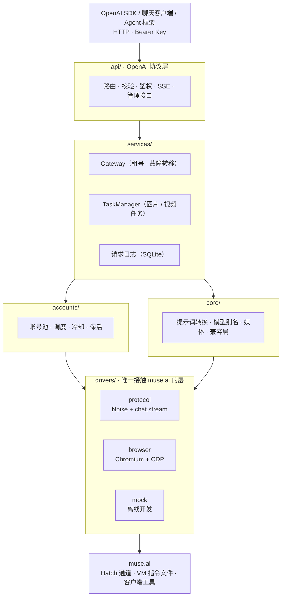
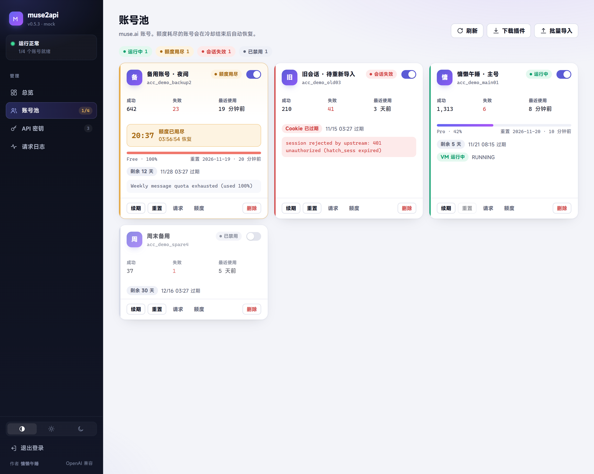

<div align="center">
  
  <h1>muse2api</h1>
  <p><b>把 muse.ai 网页版变成 OpenAI 兼容 API 的反向代理网关</b></p>
  <p>
    
    
    
    
    
  </p>
  <p>作者：<b>慵懒午睡</b></p>
</div>

---

## 目录

- [这是什么](#这是什么)
- [核心特性](#核心特性)
- [架构](#架构)
- [快速开始](#快速开始)
- [客户端接入](#客户端接入)
- [系统提示词注入](#系统提示词注入)
- [工具调用](#工具调用)
- [接口一览](#接口一览)
- [管理控制台](#管理控制台)
- [配置](#配置)
- [部署](#部署)
- [已知限制](#已知限制)
- [项目结构](#项目结构)
- [进一步阅读](#进一步阅读)
- [致谢](#致谢)
- [免责声明](#免责声明)
- [许可证](#许可证)

## 这是什么

muse2api 是一个**自托管的网页反代网关**：它把 [muse.ai](https://muse.ai) 网页应用里的对话、文生图、文生视频等能力，转成标准的 OpenAI 接口（`/v1/chat/completions`、`/v1/images/generations`、`/v1/videos` ……）。任何 OpenAI SDK、聊天客户端或 Agent 框架，只要把 `base_url` 指向本服务，就能把 muse.ai 当成一个模型来用。

它不是某个聊天平台的专用插件。网关对外只说 OpenAI 协议，对内通过可插拔驱动访问 muse.ai：既可以用原生 Noise / `chat.stream` 协议直连（推荐，不需要浏览器），也可以用 Chromium + CDP 驱动网页。

muse.ai 本质上是一个**网页 Agent**，而不是普通的指令跟随 LLM。因此这个项目在协议层之外，还做了三件普通反代不会做的事：

1. **原生系统提示词注入**：维护 muse.ai 每次会话都会读取的四个 VM 指令文件，让角色设定、账号身份和会话边界真正生效；
2. **原生工具调用**：把 OpenAI `tools` 注册成 muse.ai 的原生客户端命令，让 Agent 在自己的工具循环里真实调用，再还原成标准 `tool_calls`；
3. **会话隔离与热线程复用**：按 API Key 和会话标识隔离上下文，续接同一线程以降低首字延迟。

## 核心特性

| 能力 | 说明 |
|---|---|
| OpenAI 兼容协议层 | 聊天（流式 / 非流式）、图片生成与编辑、视频任务、模型列表、`/v1/responses` |
| 原生协议驱动 | Noise XX + protobuf + `chat.stream`，逐字流、真实线程、图片与视频，不需要 Chromium |
| 浏览器驱动 | Chromium + CDP，作为兼容回退，覆盖完整网页流程 |
| 系统提示词注入 | 原生四文件栈（IDENTITY / SOUL / USER / AGENTS.md）+ 每轮 Persona bridge |
| 原生工具调用 | `client.register_capabilities` → `client.invoke` → 标准 OpenAI `tool_calls`，并保留 JSON Planner 兜底 |
| 账号池 | `lru` / `round_robin` / `affinity` 调度、按账号并发限制、失败冷却、自动故障转移 |
| 会话管理 | 多用户上下文隔离、热线程复用、角色指纹切换、SSE 心跳 |
| 媒体能力 | 文生图、参考图、异步图片任务、文生视频、透明背景抠图、媒体自动清理 |
| 运维能力 | 保活与 VM 唤醒、额度查询、Cookie 导入插件、API Key 管理、请求日志与统计 |
| 管理控制台 | 单页 WebUI：总览、账号池、密钥、请求日志，支持明暗主题与移动端 |

## 架构



一次聊天请求的流程：路由解析模型别名并把多轮 `messages` 合并成一条提示词，Gateway 从账号池租用一个账号，驱动负责建立或复用 muse.ai 线程并返回文本流。出错时按错误类型更新账号状态（会话失效下线、额度耗尽冷却、其他错误短暂冷却），在尚未向客户端发送内容之前自动换号重试。

流式请求会先拿到第一个 chunk 再返回 200，因此“没有可用账号”“上游鉴权失败”这类错误会以正常的 HTTP 状态码返回，而不是断在流中间。

完整分层设计见 [docs/ARCHITECTURE.md](docs/ARCHITECTURE.md)，原生协议细节见 [docs/PROTOCOL.md](docs/PROTOCOL.md)。

## 快速开始

### Docker（推荐）

下载源码或克隆仓库后，在项目目录执行：

```bash
cp .env.example .env
docker compose up -d --build
```

服务默认监听 `127.0.0.1:18610`。首次启动如果没有设置 `MUSE2API_API_KEY`，会自动生成一个密钥并保存到 `data/api_key`。

### 本地运行

```bash
python3 -m venv .venv
source .venv/bin/activate          # Windows: .venv\Scripts\activate
pip install -e '.[dev]'
cp .env.example .env
python -m muse2api
```

默认使用 `mock` 驱动，不需要账号、不发任何网络请求，适合先跑通接口和前端。

### 接入真实账号

1. 在 `.env` 中设置 `MUSE2API_DRIVER=protocol`（推荐）或 `browser`。
2. 从已登录 muse.ai 的浏览器导出 Cookie。至少需要 `hatch_sess` 和 `hatch_native_auth_device`；`hatch_gw`、`hatch_vml` 存在时会一并使用。
3. 通过管理接口或控制台导入账号：

```bash
curl http://localhost:18610/admin/accounts \
  -H "Authorization: Bearer $ADMIN_KEY" \
  -H "Content-Type: application/json" \
  -d '{"label":"main","cookies":{"hatch_sess":"...","hatch_native_auth_device":"..."}}'
```

也可以在控制台的「账号池」页下载 Chrome 插件，一键读取 muse.ai 的 httpOnly Cookie 并导入。

如果 muse.ai 只能通过代理访问，请同时设置 `MUSE2API_UPSTREAM_PROXY`（协议连接、会话续期和 VM 唤醒都走它）；浏览器驱动还需要 `MUSE2API_BROWSER_PROXY`。

### 推荐环境变量（协议驱动）

```bash
MUSE2API_DRIVER=protocol
MUSE2API_UPSTREAM_PROXY=http://<proxy>:7893
MUSE2API_ACCOUNT_MAX_CONCURRENCY=4
MUSE2API_KEEPALIVE_ENABLED=true
MUSE2API_NATIVE_PROFILE=chameleon
MUSE2API_TOOL_CHANNEL=auto
```

## 客户端接入

### OpenAI SDK

```python
from openai import OpenAI

client = OpenAI(base_url="http://localhost:18610/v1", api_key="<API_KEY>")
resp = client.chat.completions.create(
    model="muse-chat",
    messages=[{"role": "user", "content": "写一首关于秋天的短诗"}],
)
print(resp.choices[0].message.content)
```

### 通用聊天客户端

在任意支持 OpenAI 兼容接口的客户端里新建 Provider：

| 字段 | 值 |
|---|---|
| API Base | `http://<网关地址>:18610/v1` |
| API Key | `MUSE2API_API_KEY`，或控制台创建的 `m2a-...` 密钥 |
| 模型 | `muse-chat`，或别名 `gpt-4o` / `dall-e-3` |
| 超时 | 建议 ≥ 240 秒（muse.ai 冷启动较慢） |

已验证 OpenAI 官方 SDK 与 AstrBot 4.29.4 的真实请求；LobeChat、Cherry Studio、ChatGPT-Next-Web 等兼容 OpenAI 的客户端按同样方式配置即可。带 `system` 提示词的请求会自动走 Persona bridge；带 `tools` 的请求会自动启用工具通道。

### 多轮对话与并发

默认无状态：每个请求开一个新线程并发送完整历史，客户端之间不会串上下文。传入稳定的 `user` 字段（或兼容客户端的会话请求头）后，同一会话会续接同一个 muse.ai 线程，后续只发送新的用户消息，首字延迟明显降低。

每个账号同时服务 `MUSE2API_ACCOUNT_MAX_CONCURRENCY` 段对话。浏览器驱动会额外预热 `MUSE2API_WARM_THREADS` 个线程；协议驱动则通过复用已订阅的会话线程降低首字延迟。一个 muse.ai 账号运行在一台云端 VM 上，同账号的并发会互相拖慢；多人使用时建议准备多个账号，让账号池分摊请求。

## 系统提示词注入

muse.ai 的 harness 会在**每次会话开始时**读取 VM 根目录下的四个 Markdown 指令文件。这就是它的原生 system prompt 入口：

| 文件 | 作用 |
|---|---|
| `IDENTITY.md` | 名字、角色、气质、Emoji；服务端 `GET /identity` 会重新解析 |
| `SOUL.md` | 价值观与行为准则 |
| `USER.md` | 关于“正在和谁说话”的备注；Muse 会遵循里面写的内容 |
| `AGENTS.md` | 长期有效的操作约定，也会引用 USER / SOUL |

网关通过 `POST /fs/write` 写入这些文件（`{path, data_base64, overwrite, append, create_parent}`），读取用 `POST /fs/read`（`{path, offset, len}`）。

设置 `MUSE2API_NATIVE_PROFILE=chameleon` 后，网关会把四个文件维护成“变色龙”基线：

- 账号身份不再写死，而是**服从每个会话开头给出的角色设定**；
- `USER.md` 明确要求不要把账号主人的昵称（例如「小红」）用于其他会话的人；
- `AGENTS.md` 说明网关注册的客户端命令可以像真实工具一样调用；
- 写入按指纹幂等，首次修改前自动备份原始文件到 `data/native_profile_backup/<账号>/`；
- `MEMORY.md` 是账号级长期记忆，**网关永远不会写入它**。

管理接口：

```bash
GET  /admin/native-profile/{account_id}          # 查看四个文件的状态
POST /admin/native-profile/{account_id}/reset    # 从备份恢复原始文件
```

注入边界是实测出来的：文件内容会作为 **Muse 自己的笔记**进入上下文，身份、价值观、用户备注和操作约定会被采纳；与文件用途无关的隐藏行为规则（例如“在回复前输出某个 token”）会被模型明确拒绝。因此网关只使用这套通道做“身份 / 边界 / 约定”，不把它当作任意 prompt 注入器。

更完整的逆向记录、`fs.write` schema 和验证过程见 [docs/PROTOCOL.md](docs/PROTOCOL.md) 第 4 节。

## 工具调用

muse.ai 的网页端有一套原生客户端工具协议。网关把它接成了标准 OpenAI 工具调用：

1. 请求里带 `tools` 时，网关调用 `client.register_capabilities`，把每个 OpenAI 工具注册成真实的 Muse 客户端命令（命名空间 `ui.navigate.<工具名>`，包含参数 schema 和超时）；
2. Muse 在自己的工具循环里调用命令，网关收到 `client.invoke` 事件，捕获 `{tool, arguments}` 并立即应答，避免命令超时；
3. 捕获到的调用被重编码为标准 OpenAI `tool_calls`，参数按 JSON Schema 归一化；
4. 提示词里保留扁平 JSON Planner 作为兜底输出契约，Muse 走哪条路径都能产出 `tool_calls`；
5. 客户端把工具结果发回来后，网关续接同一线程，让 Agent 基于结果继续回答。

```json
{
  "id": "call_...",
  "type": "function",
  "function": {
    "name": "get_group_member_info",
    "arguments": "{\"group_id\":\"123456\",\"user_id\":\"789\"}"
  }
}
```

`finish_reason` 为 `tool_calls`，流式请求同样返回标准的 `delta.tool_calls`。

- `MUSE2API_TOOL_CHANNEL=auto`（默认）：优先原生通道，Planner 兜底；
- `native`：只用原生通道；
- `planner`：只使用扁平 JSON Planner（兼容模式）。

## 接口一览

所有 `/v1/*` 接口使用 `Authorization: Bearer <API_KEY>`；`/admin/*` 使用 `MUSE2API_ADMIN_KEY`（未设置时回退到 API Key）。

| 方法 | 路径 | 说明 |
|---|---|---|
| GET | `/healthz` · `/readyz` | 存活 / 就绪检查 |
| GET | `/v1/models` | 模型列表与别名 |
| POST | `/v1/chat/completions` | 聊天，支持流式、图片输入、工具调用 |
| POST | `/v1/responses` | OpenAI Responses API（兼容实现） |
| POST | `/v1/images/generations` · GET `/v1/images/generations/{id}` | 文生图；`"async": true` 返回可轮询任务 |
| POST | `/v1/images/edits` | multipart 参考图 + 提示词 |
| POST | `/v1/videos` · GET `/v1/videos/{id}` | 创建 / 查询视频任务 |
| GET | `/v1/media/{name}` | 下载生成的媒体文件 |
| GET/POST/PATCH/DELETE | `/admin/accounts[/{id}]` | 账号增删改查 |
| POST | `/admin/accounts/import` | 批量导入账号，逐条返回结果 |
| POST | `/admin/accounts/{id}/renew` · `/reset` | 续期会话 / 重置状态 |
| GET | `/admin/accounts/{id}/quota[?refresh=1]` | 额度快照 |
| GET/POST | `/admin/native-profile/{id}[/reset]` | 原生指令文件状态 / 恢复 |
| GET/POST/PATCH/DELETE | `/admin/keys[/{id}]` | 客户端 API Key 管理 |
| GET | `/admin/requests` · `/admin/stats` | 请求日志与聚合统计 |
| GET | `/admin/status` · `/admin/tasks` | 服务状态 / 任务列表 |
| GET | `/admin/extension.zip` | Cookie 导入插件 |
| GET | `/dashboard` | 管理控制台 |

更多调用示例（文生图、参考图、透明背景、异步任务、视频）见下方折叠示例与 [docs/ARCHITECTURE.md](docs/ARCHITECTURE.md)。

<details>
<summary><b>文生图 / 参考图 / 透明背景</b></summary>

```bash
# 文生图
curl http://localhost:18610/v1/images/generations \
  -H "Authorization: Bearer $KEY" -H "Content-Type: application/json" \
  -d '{"prompt":"雨夜的赛博朋克街道","size":"16:9","response_format":"url"}'

# 用参考图生成（最多 4 张）
curl http://localhost:18610/v1/images/generations \
  -H "Authorization: Bearer $KEY" -H "Content-Type: application/json" \
  -d '{"prompt":"模特穿着这件卫衣，棚拍","image":"data:image/jpeg;base64,..."}'

# OpenAI 风格 multipart 图片编辑
curl http://localhost:18610/v1/images/edits \
  -H "Authorization: Bearer $KEY" \
  -F "image[]=@fox.png" -F "prompt=同一只狐狸，戴上红围巾"

# 透明背景（本地 BiRefNet 抠图，需要 pip install -e '.[matting]'）
curl http://localhost:18610/v1/images/generations \
  -H "Authorization: Bearer $KEY" -H "Content-Type: application/json" \
  -d '{"prompt":"一只坐着的红狐狸","background":"transparent"}'
```

</details>

<details>
<summary><b>异步图片与视频任务</b></summary>

```bash
# 异步图片
curl http://localhost:18610/v1/images/generations \
  -H "Authorization: Bearer $KEY" -H "Content-Type: application/json" \
  -d '{"prompt":"一只红狐狸","async":true}'
curl http://localhost:18610/v1/images/generations/task_xxx -H "Authorization: Bearer $KEY"

# 文生视频
curl http://localhost:18610/v1/videos \
  -H "Authorization: Bearer $KEY" -H "Content-Type: application/json" \
  -d '{"prompt":"枫叶在微风中飘落","duration":5,"size":"16:9"}'
curl http://localhost:18610/v1/videos/task_xxx -H "Authorization: Bearer $KEY"
```

</details>

## 管理控制台

打开 `http://localhost:18610/dashboard`，输入管理密钥即可登录。密钥保存在浏览器 localStorage，并以 Bearer Token 调用 `/admin/*`。


- **总览**：请求量、错误率、P95 延迟、账号可用性、请求趋势图、密钥 / 账号 / 模型 / 状态码分布；
- **账号池**：账号卡片、额度条、Cookie 过期时间、VM 唤醒状态、启停、续期、重置、批量导入；
- **API 密钥**：创建、重命名、吊销、恢复、删除，24 小时用量与错误数；
- **请求日志**：逐请求明细、按密钥 / 账号 / 状态 / 路径筛选、自动刷新、分页。



控制台是单文件、零外部依赖的前端，支持明暗主题、键盘操作和移动端抽屉布局。

## 配置

所有配置来自环境变量（前缀 `MUSE2API_`）或 `.env`。完整列表见 [.env.example](.env.example)。

| 变量 | 默认值 | 说明 |
|---|---|---|
| `MUSE2API_DRIVER` | `mock` | `mock` / `protocol` / `browser` / `http` |
| `MUSE2API_HOST` · `MUSE2API_PORT` | `127.0.0.1` · `18610` | 监听地址与端口 |
| `MUSE2API_API_KEY` | 自动生成 | `/v1/*` 密钥 |
| `MUSE2API_ADMIN_KEY` | 同 API Key | `/admin/*` 密钥 |
| `MUSE2API_UPSTREAM_PROXY` | 空 | 协议连接、续期、VM 唤醒使用的代理 |
| `MUSE2API_BROWSER_PROXY` | 空 | 浏览器驱动专用代理 |
| `MUSE2API_POOL_STRATEGY` | `affinity` | `lru` / `round_robin` / `affinity` |
| `MUSE2API_ACCOUNT_MAX_CONCURRENCY` | `4` | 每账号并行请求数 |
| `MUSE2API_WARM_THREADS` | `2` | 每账号预热线程数，`0` 关闭 |
| `MUSE2API_MAX_FAILOVER` | `2` | 换账号重试次数 |
| `MUSE2API_ACCOUNT_COOLDOWN` | `120` | 账号错误后的冷却秒数 |
| `MUSE2API_NATIVE_PROFILE` | `off` | `chameleon` 启用原生四文件栈 |
| `MUSE2API_NATIVE_PROFILE_DIR` | 空 | 自定义四文件内容目录 |
| `MUSE2API_TOOL_CHANNEL` | `auto` | `auto` / `native` / `planner` |
| `MUSE2API_EMULATE_TOOLS` | `true` | 是否启用工具调用 |
| `MUSE2API_KEEPALIVE_ENABLED` | `true` | 后台续期与 VM 唤醒 |
| `MUSE2API_KEEPALIVE_INTERVAL` | `600` | 保活间隔（秒） |
| `MUSE2API_CHAT_TIMEOUT` | `300` | 聊天总超时（秒） |
| `MUSE2API_FIRST_TOKEN_TIMEOUT` | `75` | 首 token 超时（秒） |
| `MUSE2API_STREAM_HEARTBEAT_INTERVAL` | `0` | SSE 心跳间隔，`0` 关闭 |
| `MUSE2API_MEDIA_RETENTION_DAYS` | `14` | 媒体文件保留天数，`0` 关闭清理 |
| `MUSE2API_REQUEST_LOG_RETENTION_DAYS` | `14` | 请求日志保留天数 |
| `MUSE2API_MATTING_MODEL` | `birefnet-general` | 透明背景抠图模型 |

## 部署

### Docker Compose

```bash
docker compose up -d --build
```

### 纯协议镜像（无 Chromium，约 194 MB）

```bash
docker build --network host \
  --build-arg HTTPS_PROXY=http://<proxy>:7893 \
  -f Dockerfile.protocol \
  -t muse2api:latest .

docker run -d --name muse2api \
  --restart unless-stopped \
  -p 18610:18610 \
  -v /path/to/data:/app/data \
  -e MUSE2API_DRIVER=protocol \
  -e MUSE2API_UPSTREAM_PROXY=http://<proxy>:7893 \
  -e MUSE2API_NATIVE_PROFILE=chameleon \
  -e MUSE2API_TOOL_CHANNEL=auto \
  muse2api:latest
```

### 反向代理

网关本身可以直接暴露 18610 端口；放在 Nginx / Caddy / Cloudflare 后面时：

- 关闭响应缓冲，确保 SSE 逐字输出；
- 读取超时建议 ≥ 300 秒（视频任务建议 600 秒）；
- 保留 `Authorization` 与 `x-astrbot-conversation-id` 等会话头；
- 如果反向代理有约 100 秒的超时限制，图片生成请使用 `"async": true` 任务模式。

### 升级与回滚

数据都在 `data/`：`accounts.json`、`keys.json`、`requests.db`、`media/`、`native_profile_backup/`。升级前备份该目录即可；回滚只需换回旧镜像，数据格式向后兼容。

## 已知限制

1. muse.ai 是 Agent，不是可完全控制的 LLM：它仍可能拒绝扮演某些角色、拒绝写入长期记忆，或用出戏句子开头。适配层会清洗和重试，但无法保证 100% 一致。
2. 工具调用优先走原生通道，Planner 是兜底；极少数情况下连续拒绝、重试耗尽后会返回普通文本而不是 `tool_calls`。
3. 账号主人自己的长期记忆（`MEMORY.md`）属于账号级，协议层无法删除；网关永不写入它，并用原生 `USER.md` 与每轮提示词中和昵称外泄。
4. 图片输入会作为附件发给 muse.ai；历史图片只保留占位符，跨线程依赖完整图片细节时可能丢失。
5. 账号额度与并发受 muse.ai 套餐限制，多人使用请增加账号而不是无限提高单账号并发。

## 项目结构

```
muse2api/
├── src/muse2api/
│   ├── app.py                  # FastAPI 应用工厂与 lifespan
│   ├── config.py               # 环境变量 / .env 配置
│   ├── api/
│   │   ├── deps.py             # 鉴权与会话键
│   │   ├── schemas.py          # OpenAI 请求模型
│   │   └── routes/             # chat / images / videos / media / models / admin / dashboard
│   ├── services/
│   │   ├── gateway.py          # 账号池上的驱动调用与故障转移
│   │   ├── tasks.py            # 图片 / 视频后台任务
│   │   ├── request_log.py      # SQLite 请求日志
│   │   └── container.py        # 服务装配
│   ├── accounts/               # 账号模型、存储、池、保活
│   ├── core/                   # 模型别名、提示词、媒体、客户端兼容层
│   ├── drivers/
│   │   ├── protocol/           # Noise、protobuf、chat.stream、原生指令文件、工具通道
│   │   ├── browser/            # Chromium + CDP
│   │   └── mock.py             # 离线驱动
│   └── web/                    # 单页控制台 + Cookie 导入插件
├── tests/                      # 229 个离线测试
├── docs/                       # 架构、协议、客户端接入、测试报告
├── Dockerfile · Dockerfile.protocol · docker-compose.yml
└── .env.example
```

## 进一步阅读

- [docs/ARCHITECTURE.md](docs/ARCHITECTURE.md)：分层、请求生命周期、扩展点
- [docs/PROTOCOL.md](docs/PROTOCOL.md)：Noise 握手、`chat.stream`、原生指令文件栈、工具通道
- [docs/CLIENTS.md](docs/CLIENTS.md)：客户端兼容层的行为、配置与限制
- [docs/CLIENT-TEST-REPORT.md](docs/CLIENT-TEST-REPORT.md)：真实客户端联调与生产验证记录

## 致谢

这个项目建立在两个开源项目的工作之上，特此致谢：

- **[www222fff/muse2api](https://github.com/www222fff/muse2api)**：本项目的起点。OpenAI 协议层、账号池、驱动分层、管理后台、Cookie 导入插件等基础实现都来自这里。
- **[AstrBot](https://github.com/AstrBotDevs/AstrBot)**：客户端兼容层的设计参考和真实联调环境。Persona 处理、工具循环、流式响应与多会话隔离的适配经验来自与它的联合调试。

也感谢 [muse.ai](https://muse.ai) 提供了这样一个能力完整的网页 Agent，让协议研究成为可能。

## 免责声明

本项目仅用于学习、技术研究与自托管实践。请遵守 muse.ai 的服务条款和当地法律，不要用于商业转售、批量注册或其他滥用行为。切勿提交、公开或分享账号 Cookie。因使用本项目产生的任何后果由使用者自行承担。

## 许可证

[MIT](LICENSE) © 2026 慵懒午睡
