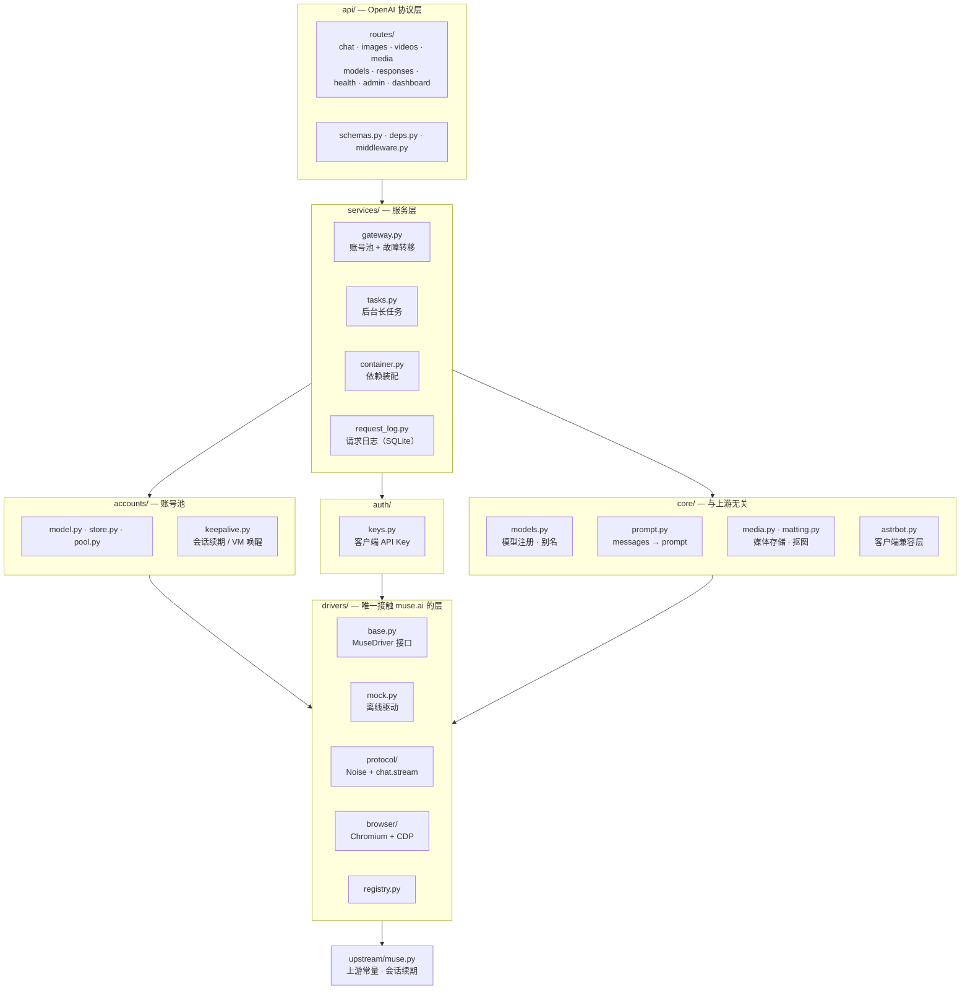

# 架构设计

## 分层



依赖严格向下流动：`api → services → accounts/auth/core → drivers → upstream`。路由不会直接调用驱动，驱动也不感知 HTTP 协议层。

## 一次聊天请求的生命周期

1. `routes/chat.py` 校验请求，`resolve_model` 解析模型别名，`flatten_messages` 把多轮对话合并成一条提示词并提取图片。
2. 如果请求带 `system` 提示词或 Agent 客户端特征，`core/astrbot.py` 会把 Persona 放入当前用户轮，并生成会话键。
3. `Gateway.chat_stream` 通过 `AccountPool.lease()` 租用一个账号（受调度策略和单账号并发限制约束）。
4. 调用 `driver.chat_stream(account, ChatRequest)`，接收文本增量。
5. 出错时：
   - `UpstreamAuthError`：账号标记为 `invalid`；
   - `UpstreamQuotaError`：账号至少冷却一小时；
   - 其他可重试错误：账号冷却 `account_cooldown` 秒；
   - 如果还没向客户端发送任何内容，换一个账号重试（最多 `max_failover` 次）。
6. 流式请求会先拉取第一个增量再返回 200，因此“没有可用账号”“上游鉴权失败”等错误会以正确的 HTTP 状态码返回，而不是返回一个中途断开的流。

## 驱动契约

```python
class MuseDriver(ABC):
    name: str
    requires_account: bool
    capabilities: DriverCapabilities

    async def startup(self) / shutdown(self)
    async def health(self) -> dict
    def chat_stream(self, account, ChatRequest) -> AsyncIterator[str]   # 必须实现
    async def generate_image(self, account, ImageRequest) -> list[MediaResult]
    async def generate_video(self, account, VideoRequest) -> MediaResult
    async def renew_session(self, account) -> SessionInfo
    async def quota(self, account) -> dict
```

- 未实现的能力抛出 `FeatureNotImplemented`（HTTP 501），上层可以优雅降级。
- 错误必须映射到 `errors.py` 里的 `Upstream*` 类型；账号池依赖这些类型判断账号状态。
- 驱动不负责重试、持久化和 URL 拼装。

## 协议驱动要点

- 通过 HTTP 引导 + Noise XX 握手建立到 Hatch 通道的加密 WebSocket，再以 protobuf 承载 `chat.stream` / `chat.subscribe` 等 RPC，详见 [PROTOCOL.md](PROTOCOL.md)。
- 每个会话对应一个 `session_id`，线程订阅只接收该线程的事件，因此不同用户的上下文在协议层就是隔离的。
- `delta.text_append` 直接映射为 OpenAI `delta.content`，是真正的逐字流，不依赖 DOM 轮询。
- 连接按账号复用；空闲线程超过 `MUSE2API_PROTOCOL_THREAD_TTL` 后回收，超过 `MUSE2API_PROTOCOL_MAX_THREADS` 时关闭最旧的空闲线程。
- 原生系统提示词：`drivers/protocol/profile.py` 通过 `fs.write` 维护 `IDENTITY.md` / `SOUL.md` / `USER.md` / `AGENTS.md`，按指纹幂等，并在首次修改前备份。
- 原生工具通道：`register_capabilities` 声明 `ui.navigate.*` 命令，`client.invoke` 事件被重编码为标准 OpenAI `tool_calls`。

## 浏览器驱动要点

- 一个 Chromium 进程。每个账号通过 `Target.createBrowserContext` 获得独立上下文（最多 `MUSE2API_ACCOUNT_MAX_CONCURRENCY` 个标签页，一个标签页一个窗口——Chromium 会节流共享窗口的后台标签页），切换账号不需要清 Cookie。
- 除非客户端传 `user`，聊天默认无状态：匿名请求总是用完整历史打开 `/thread/new`，结束后不保留。带 `user` 时（按 API Key 作用域 `<key_id>:<user>`），历史能续接的请求会留在同一会话，只发送新的用户文本。线程 URL 存在账号上，后续请求可以重新打开该会话而不是新建。默认账号池策略是 `affinity`。
- 所有 DOM 选择器和页面内脚本都在 `drivers/browser/dom.py`。muse.ai 改版时通常只需要改这个文件。
- 文本通过原生 value setter + `input` 事件写入 textarea，React 能感知，长提示词也很快；找不到发送按钮时回退到回车。
- 输出检测轮询最后一条助手气泡的文本并增量输出；Stop 按钮消失且文本稳定后视为完成。
- 媒体：等待新的附件节点，在页面内 `fetch()` 它的 `blob:` URL，以 base64 返回字节。

## 扩展点

预留模块和未完成工作统一记录在仓库根目录的 [TODO.md](../TODO.md)。
